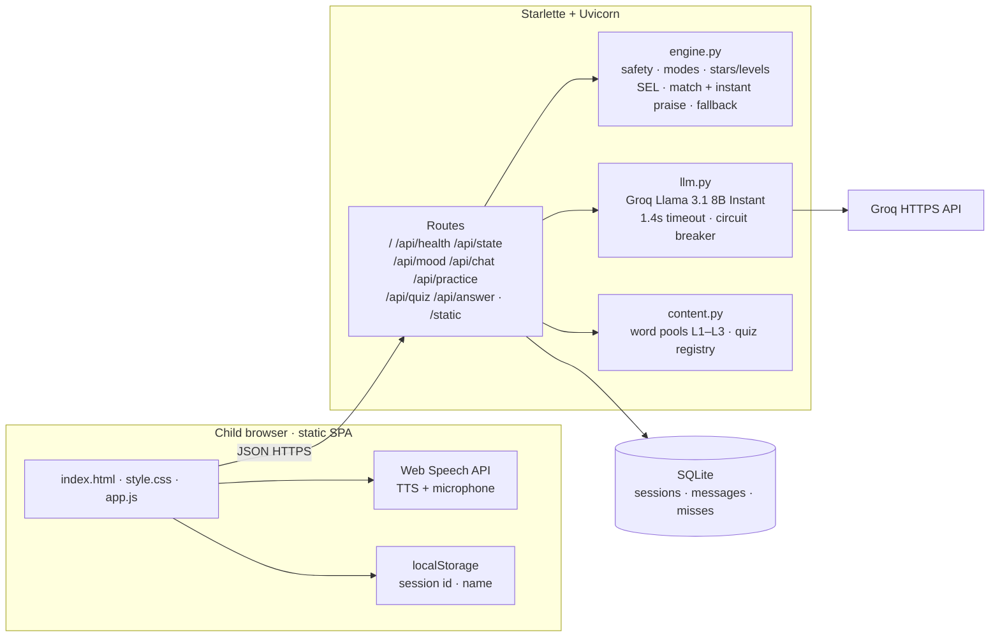
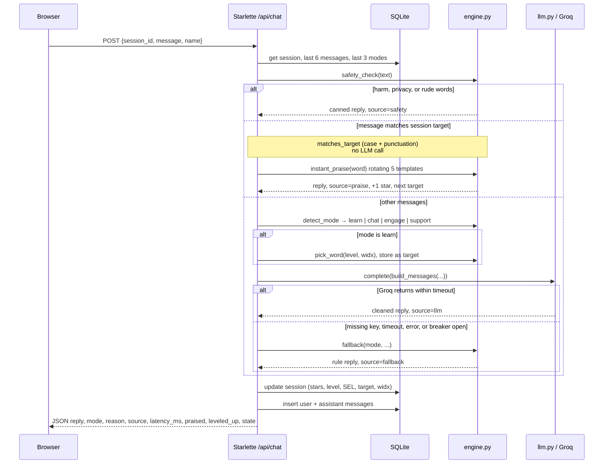

# Sketchbook architecture

Single-page browser app talking to a Starlette API. The mascot is **Dora**. State lives in SQLite. Optional replies come from Groq; safety, modes, target matching and fallbacks stay in `engine.py`.

## Component diagram

## Sequence: one `POST /api/chat` request

