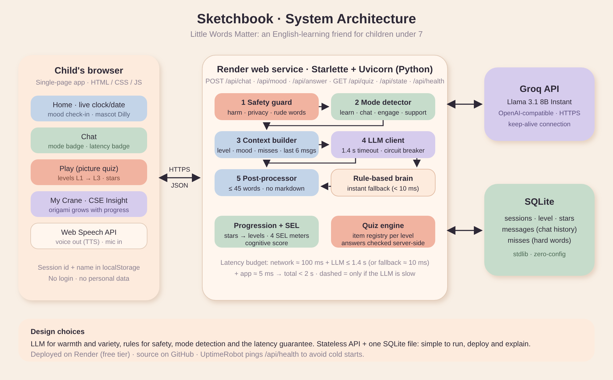

# Sketchbook: System Design

**Product:** an AI-powered English-learning friend for children under 7.
**Tagline:** *Little Words Matter*. **Mascot:** Dilly, a doll friend.

## 1. Goals and how they are met

| Requirement | Design response |
|---|---|
| Progressive learning L1/L2/L3 | Stars are the single progress currency. 6 stars unlock L2, 14 unlock L3. Each level has its own word pool (chat teaching) and quiz items (Play). A child earns stars by answering quiz items or by saying the word Dilly just taught. |
| Child mode detection | `engine.detect_mode()` classifies every message into **learn / chat / engage / support** using intent patterns, the mood check-in, and recent history. Three learning turns in a row switch to *engage* (a game), so the bot never teaches non-stop. The UI shows the detected mode and the reason. |
| Social & Emotional Learning | Mood check-in, a gentle *support* mode with a guided breathing animation, praise-first feedback, “mistakes help us grow” wording, and four tracked SEL meters (awareness, confidence, curiosity, kindness). |
| Context-aware responses | The LLM prompt contains level, stars, mood, current mode, recently missed words, and the last 6 messages. The word being taught depends on the level and the child's progress. |
| < 2 s end-to-end latency | See section 3. |
| Live deployed URL | Render web service (free tier). |

## 2. Components

- **Front-end**: static SPA (no build step). Screens: Splash → Home → Chat / Play / My Crane. Web Speech API gives voice output and microphone input, important for children who cannot read yet.
- **API**: Starlette (ASGI) served by Uvicorn. Stateless handlers; all state is in SQLite. Starlette was chosen over a heavier framework because the app has six small endpoints, no validation-heavy schemas, and a faster cold start on a free tier.
- **Rule-based brain** (`engine.py`): safety guard, mode detection, progression, SEL scoring, and offline replies.
- **LLM client** (`llm.py`): Groq (Llama 3.1 8B Instant) through an OpenAI-compatible endpoint, with timeout, circuit breaker and post-processing.
- **Quiz engine** (`content.py`): item registry; answers are checked on the server, so the client cannot cheat and the LLM is not needed (instant and free).
- **Persistence** (`db.py`): SQLite with three tables: `sessions`, `messages`, `misses`.

## 3. Latency design (< 2 s)

| Step | Budget |
|---|---|
| Browser ↔ server network | ~100 ms |
| Safety + mode detection + context | < 5 ms |
| LLM call (Groq, ~80 output tokens, keep-alive connection) | typically 300–700 ms, **hard cap 1.4 s** |
| Rule-based fallback if the LLM times out or errors | < 10 ms |
| Post-processing + DB write | < 5 ms |

- A **circuit breaker** skips the LLM for 30 s after 3 consecutive failures.
- The TLS connection to Groq is **pre-warmed** at startup and reused.
- Replies are capped at ~30 words, which keeps generation short and also suits the age group.
- The UI shows the measured latency of every reply, and `tests/smoke.py` checks it automatically, on localhost or on the live URL.
- **Honest caveat:** on Render's free plan the service sleeps after inactivity, and the first request can take ~30 s. The front-end wakes it during the splash screen, and an UptimeRobot monitor pinging `/api/health` every 5 minutes keeps it warm.

## 4. Safety (children)

- Input guard: self-harm/abuse phrases lead to a calm reply that tells the child to speak to a trusted adult; phone numbers/addresses are never processed (the bot says “let's keep that a secret”); unkind words get a kindness redirect. These replies never reach the LLM.
- System prompt forbids asking for personal information, lists, hard words, and telling a child they are wrong.
- No accounts, no email, no tracking. The only stored data is a random session id and an optional first name.

## 5. Data model

`sessions(id, name, mood, level, stars, correct, total, streak, widx, target, aw, conf, cur, kind, …)`
`messages(sid, role, content, mode, ts)` · `misses(sid, word, ts)`

`target` is the word Dilly last taught; if the child says it, they earn a star and the next word is introduced (`widx`).

## 6. Trade-offs

| Decision | Alternative | Why this way |
|---|---|---|
| Cloud LLM (Groq) | Local model (Ollama) | A hosted URL cannot reach a laptop GPU. Groq is the fastest free option for the 2 s budget. |
| Rules + LLM hybrid | LLM only | Guaranteed latency, safety and free offline operation when the API is down. |
| SQLite on the instance | Postgres | Zero setup. Trade-off: Render's free disk is ephemeral, so progress can reset on redeploy (fine for a demo, swap for Postgres to scale). |
| Mode detection by rules | Separate classifier model | Instant, explainable, shown in the UI. A small classifier could replace it later. |
| Starlette + vanilla JS | FastAPI + React | Fewer moving parts, no build step, faster to ship and review. |

## 7. Scaling and next steps

Move SQLite → Postgres, add per-session rate limiting, stream replies token-by-token, add a parent dashboard fed by the same SEL meters, replace emoji art with illustrated assets, add speech-pronunciation scoring.
